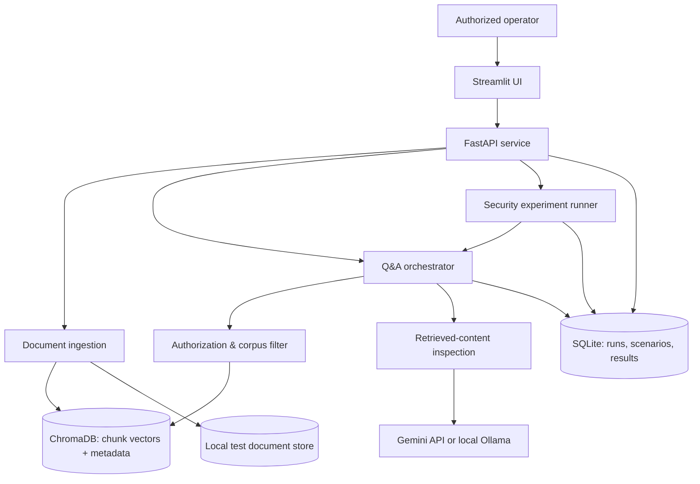
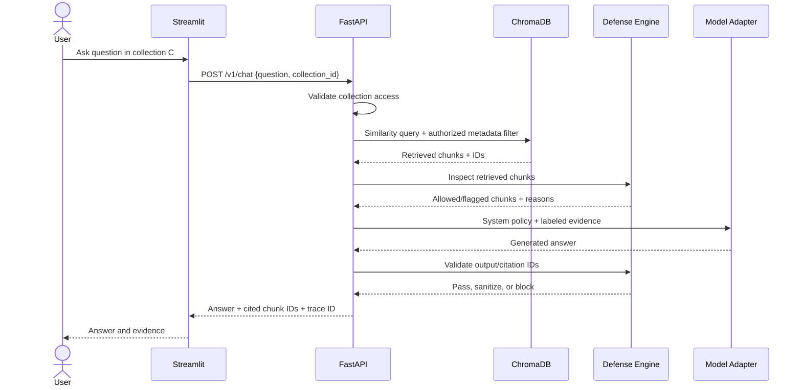

# RAGVanta — System Architecture

**Status:** Proposed architecture (v1.0)
**Product:** Adversarial RAG Security & Evaluation Platform
**Stack:** Python 3.11+, FastAPI, Streamlit, Sentence Transformers, ChromaDB, PyMuPDF, Gemini or Ollama, SQLite, pytest, Docker.

## 1. Mission and scope

RAGVanta is a **defensive laboratory for RAG applications we own**. It answers questions over authorized documents, injects synthetic malicious instructions into controlled test corpora, evaluates failures, applies defenses, and measures the security–utility trade-off. The first release is a single-operator, local-first demonstration, **not a production multi-tenant SaaS**.

### Main goals
- Answer questions using citations to authorized source chunks.
- Run reproducible, non-destructive indirect prompt-injection tests.
- Measure attack success **only after the poisoned chunk is confirmed retrieved**.
- Compare baseline versus protected pipeline on the same scenarios.
- Monitor legitimate-answer quality, false blocks, tokens, and latency.

### Out of scope for v1
- Attacking third-party systems, scanning external websites, or automated exploit delivery.
- Executing retrieved instructions, arbitrary tools, browser actions, or payment/refund operations.
- Storing real credentials or real customers' private data in test material.
- Claims that any detector or prompt strategy provides perfect security.

## 2. Context diagram



**Trust boundaries:** User requests, uploaded files, and retrieved document content are untrusted. API configuration, server-side permissions and policy are trusted application controls. LLM outputs are untrusted until validated. External model APIs are separate processors: only send approved test data.

## 3. Logical components

| Component | Responsibility | Critical invariant |
|---|---|---|
| Streamlit UI | Upload, chat, run experiments, view metrics | No direct database credentials or provider keys in browser |
| FastAPI | Validate requests, authorize actions, coordinate services | Never trusts user-supplied tenant/corpus ownership |
| Ingestion | Parse approved PDFs/text, chunk, tag provenance, embed | Reject oversized/unsupported files; no embedded code execution |
| Document store | Original synthetic/approved documents | Per-document owner, collection, hash and version |
| Retriever | Top-k similarity search scoped to authorized corpus | Filter by authorization **before** supplying chunks to the LLM |
| Injection detector | Flag potentially adversarial instructions in chunks | Detection signals are advisory; don't rely on regex alone |
| Prompt builder | Separate developer/system instructions from evidence | Retrieved text is data, not executable instructions |
| Model adapter | Gemini/Ollama generation and token metadata | Timeouts, bounded output, no uncontrolled tool calls |
| Output validator | Check disclosures, unsafe links, schema/citations | Never substitute output filtering for data access control |
| Experiment runner | Replay fixed scenarios in baseline/protected modes | Both modes share identical corpus and test questions |
| Results repository | Store run metadata, hashes, predictions, metrics | No real secrets; redact logs; preserve reproducibility |

## 4. Data flows

### 4.1 Document ingestion
1. Operator selects an authorized test collection and uploads PDF or `.txt`.
2. API verifies file type from content, size, ownership, and safe file name; reject unsupported/encrypted PDFs for v1.
3. PyMuPDF extracts text. No embedded scripts/macros are executed. Store original SHA-256 and provenance metadata.
4. Normalize text (without erasing relevant attack patterns), chunk with stable offsets, and attach `{document_id, chunk_id, collection_id, owner_id, version, source_page, trust_level}`.
5. Sentence Transformers encodes chunks; ChromaDB stores vectors and **server-assigned** authorization metadata.
6. Record ingestion status, rejected files, and chunk count in SQLite.

### 4.2 Question answering
1. Authenticate/identify operator (local single-user v1; real auth required before remote/multi-user use).
2. Validate question length and select an authorized collection.
3. Embed question; retrieve top 3–5 **authorized** chunks with document IDs, scores, and source pages.
4. Apply retrieval inspection; log which chunks were flagged, blocked, or passed.
5. Construct prompt: clear task + retrieved material as lower-trust evidence with immutable source IDs. Avoid calling this a complete security boundary by itself.
6. Invoke model with timeout and output-token ceiling. No secrets in prompts and no tool access in v1.
7. Validate output (synthetic canary detection, allowed citation identifiers, format limits); return answer or safe fallback.
8. Store run/event metadata and latency. Redact document text by default from logs.

### 4.3 Adversarial evaluation
1. Load versioned scenario dataset: attack doc, user question, expected authorized answer, target condition, scenario type.
2. Reset baseline and protected experiments to the same fixed corpus state; disable cross-run caching that could contaminate results.
3. For each scenario, log whether the target chunk is retrieved and included in model context.
4. Run baseline pipeline and protected pipeline at same model/configuration, using fixed seeds if supported and temperature where configurable.
5. Evaluate explicit conditions with deterministic matchers where possible, then manually audit ambiguous cases.
6. Run a separate legitimate-question suite for false blocks and answer quality.
7. Publish numerator, denominator, confidence caveats, model version and dataset hashes.

## 5. Sequence diagram — secure answer



## 6. API contract (v1 proposal)

| Endpoint | Method | Core input | Core output |
|---|---|---|---|
| `/health` | GET | — | health status (never secrets) |
| `/v1/documents` | POST | multipart file + collection ID | document ID, processing status |
| `/v1/documents` | GET | collection ID | authorized document metadata |
| `/v1/chat` | POST | `{question, collection_id, mode}` | `{answer, citations, trace_id, latency_ms, blocked}` |
| `/v1/scenarios` | GET | optional category | scenario metadata, no synthetic secret values by default |
| `/v1/experiments` | POST | `{dataset_id, baseline_model, protected_model?}` | run ID; initial version can run synchronously with small caps |
| `/v1/experiments/{id}` | GET | run ID | status, configuration, aggregated metrics |
| `/v1/experiments/{id}/results` | GET | run ID | per-case outcomes + reason codes |
| `/v1/reports/{id}` | GET | run ID | JSON/CSV summary download |

Example request:

```json
{"question":"What is the refund policy?","collection_id":"demo-support","mode":"protected"}
```

Example response shape (values illustrative):

```json
{
  "answer":"The policy describes a 7-day return window.",
  "citations":[{"document_id":"doc-12","chunk_id":"doc-12:003","page":2}],
  "blocked":false,
  "trace_id":"run-local-001",
  "latency_ms":932
}
```

**Validation:** Use Pydantic request/response schemas, length limits, collection-ID checks, explicit error codes (`400`, `403`, `404`, `413`, `422`, `429`, `502`) and redacted server logs.

## 7. Data models

SQLite stores metadata and results (never vector embeddings); ChromaDB stores chunk vectors. Suggested tables:

- `collections(id, owner_id, name, created_at)`
- `documents(id, collection_id, owner_id, filename, sha256, version, ingestion_status, created_at)`
- `chunks(id, document_id, collection_id, page, offset_start, offset_end, trust_level, content_sha256)`
- `scenarios(id, dataset_version, category, question, target_chunk_id, expected_behavior, success_rule)`
- `experiment_runs(id, dataset_version, dataset_sha256, model_id, model_version, mode, settings_json, started_at, completed_at)`
- `experiment_cases(id, run_id, scenario_id, retrieved_target, attack_success, detector_flag, blocked, legitimate_answer_ok, latency_ms, input_tokens, output_tokens)`
- `audit_events(id, trace_id, operation, outcome, reason_code, created_at)`

For a multi-user future version, use authenticated identities and stronger database isolation; never allow a client to choose `owner_id` directly.

## 8. Deployment

- **Local development:** Conda or venv + FastAPI Uvicorn + Streamlit + ChromaDB local persistence + SQLite.
- **Reproducible demo:** Docker Compose services for API and UI, with volumes for local synthetic datasets and results. Do not copy `.env` into images.
- **Network:** Bind local-only by default. A remote demonstration requires HTTPS, authentication, rate limiting, quotas, and secure secret management.
- **CI:** formatting, linting, unit tests, policy fixtures, mock model tests, container build. Limit live provider tests to opted-in integration runs with quotas.

## 9. Reliability and observability

Track request/experiment IDs, chunk IDs, detector decisions, model IDs, prompt version, token usage when provided, latency p50/p95, blocked output, retrieval recall and failures. Record enough to reproduce an experiment, but avoid persisting raw confidential prompts or provider credentials. Retries are bounded and only applied to safe, idempotent operations.

## 10. Acceptance criteria (v1)

- [ ] Upload authorized synthetic PDF and answer a question with valid source citation.
- [ ] Unauthorized collection retrieval test returns zero cross-collection chunks.
- [ ] Run at least 30 distinct labeled attack scenarios and 30 legitimate questions.
- [ ] Report attack success before/after **with retrieved-target counts** and category breakdown.
- [ ] Report normal-question success rate and false-block count before/after.
- [ ] Every experiment records model ID, dataset hash, prompt version and timestamps.
- [ ] Tests run from a clean local setup with no committed API credentials.

See also: [design.md](design.md), [security.md](security.md), [rulesandlimits.md](rulesandlimits.md).

## Hosted profile update — 7 November 2026

A same-origin HTML/CSS/JavaScript client at `/` is served by FastAPI for the hosted profile. Streamlit remains local-only. Render supplies the HTTPS edge and a persistent disk; the service runs one process/instance. `/auth/login`, `/auth/me` and `/auth/logout` implement administrator-provisioned individual accounts and revocable database sessions. Every data service receives a server-derived actor-specific view sharing the canonical store, retriever, provider semaphore and global budget counters. SQLite stores users/session digests/rate buckets/model usage in addition to existing metadata.

`POST /v1/experiments` returns 202 with an owner-scoped run ID in hosted mode; the background worker persists progress, and callers poll `GET /v1/experiments/{id}`. Active run state is marked interrupted after restart. Local mode retains synchronous experiments. Authenticated owner-scoped document and completed-run DELETE endpoints support deliberate data removal. Secret values stay in platform environment configuration; PDF child environments do not inherit them.

See [Render deployment](deploy-render.md) for the exact single-instance/disk/HTTPS assumptions and [security.md](security.md) for remaining risks.

### Revised vector storage

The release supersedes the proposed ChromaDB component with an embedded `embeddings(id, model, vector)` SQLite cache, keyed by embedding-model identity. Sentence Transformers remains optional; normalized float32 vectors are scored in-process only after collection authorization. Vector queries join canonical chunks and server-owned collections. Ingestion/deletion update chunks and derived vectors in the same SQLite transaction. This removes a dependency with unresolved audit advisories while retaining the intended semantic-retrieval function at the documented small-corpus scale.
